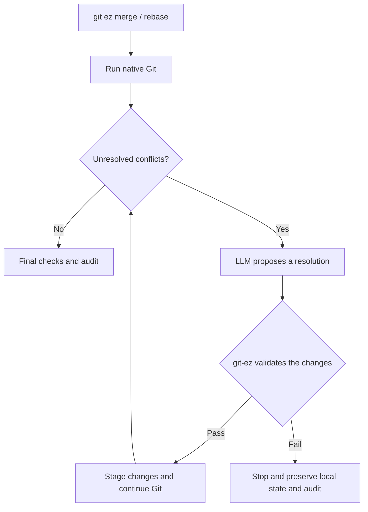

# git-ez

A Git extension for **local rebase and merge with AI-assisted conflict resolution**,
with an audit trail of changes, decisions, and their rationale.

```bash
git ez rebase main
git ez merge feature
```



The LLM is called only for unresolved conflicts. Git handles the integration;
git-ez validates and applies resolutions, continues Git, and records the audit.

The operation modifies the current branch. Users decide whether to use a dedicated
branch and whether to push the result afterward. git-ez does not create branches or
worktrees, fetch, or push.

[Installation](#installation) · [Configuration](#configuration) · [Usage](#usage) ·
[Supported scope and limitations](#supported-scope-and-limitations) · [Documentation](#documentation)

## Installation

Requires Python 3.11+ and Git 2.38+. macOS and Linux use the installation below;
FreeBSD has an experimental [native-package installation](docs/freebsd.md).
Using [uv](https://docs.astral.sh/uv/getting-started/installation/), install from the public repository:

```bash
uv tool install git+https://github.com/nico97118/git-ez
```

Or install from a local checkout:

```bash
uv tool install .
```

The Python distribution is named `git-ez-ai`; the Git extension and repository are
named `git-ez`. PyPI installation will use `uv tool install git-ez-ai` once a release
is published. Until then, use the GitHub or local installation above.

The package installs a single executable, `git-ez`. Once the directory reported by
`uv tool dir --bin` is on `PATH`, Git automatically discovers it as `git ez`.
A standard installation copies the package into an isolated environment: the source
checkout is not required at runtime. Provider connectors and the agent runtime are
included in the main dependencies.

### Command help and manual

`git ez -h` and `git ez rebase -h` display command-line usage. Git handles
`git ez --help` and `git help ez` through its manual viewer. The package includes
`git-ez.1`; for a uv tool installation, add its manual directory to your shell profile:

```bash
export MANPATH="$(uv tool dir)/git-ez-ai/share/man:${MANPATH:-}"
```

The trailing separator preserves the system manual search path. A working `man`
viewer is required (for example, `man-db` on Debian/Ubuntu). For other Python
installations, the manual is under `<environment-prefix>/share/man/man1/git-ez.1`.

## Configuration

Settings use native Git configuration under `ez.*`, respecting scopes and includes.
For an OpenAI-compatible Chat Completions server:

```bash
git config --global ez.provider openai
git config --global ez.model exact-model-id
git config --global ez.endpoint https://ai-server.example/v1
# If authentication is required, supply the token through this environment variable:
git config --global ez.apiKeyEnv INTERNAL_AI_TOKEN
```

The model must support native tool calls. Native Ollama is also supported with
`ez.provider=ollama`. Valid model configuration is required even when an integration
has no conflicts. HTTPS is required outside loopback unless explicitly overridden;
use `ez.caBundle` for an internal CA. Prefer token environment variables to
`ez.apiKey`, which Git stores in plaintext.

See the [configuration guide](docs/configuration.md), the
[sample Git configuration](examples/ez.gitconfig), and the
[manual's CONFIGURATION section](docs/man/git-ez.1) for providers and all settings.

## Usage

Start on a local branch with a clean checkout and no active Git operation.
Commit or stash local changes yourself before running git-ez. Native autostash is
disabled for both rebase and merge, even when enabled in Git configuration.
The target must already exist locally; git-ez pins its revision when the run starts.

```bash
# Check model/tool compatibility without exposing the repository or shell tools:
git ez probe
# Save the JSON report to a file instead:
git ez probe > /tmp/ai-compatibility.json

# Rebase the current branch onto main, or merge feature into the current branch:
git ez rebase main
git ez merge feature

# Review each agent proposal before staging:
git ez merge feature --interactive

# Run a final validation command in the target repository:
git ez rebase main --check python -B -m pytest

# Inspect the latest run:
git ez audit show
```

`--check` must be last: everything after it is the validation command and its
arguments, executed without a shell at the repository root. The agent may run it
during resolution; the engine runs it after integration. Its dependencies must
be available, and generated test files must be ignored or cleaned up.

With `--interactive`, review one global proposal per conflicting Git step: accept,
reject with feedback, or quit. Each rejection starts again from the original
tracked conflict baseline with prior proposal evidence and feedback.
Quit or Ctrl+C restores the original unresolved files and index so
you can continue with native Git. Restoration covers files tracked at the conflict
stop, the index and Git operation metadata. Existing Git blobs are reused; only
tracked contents that differ from the index need a temporary copy. Nontracked and
ignored files are neither backed up nor cleaned up: their check/model side effects
can remain after Quit or a retry. Avoid concurrent edits during review. Engine
checks still apply after acceptance. No conflicts means no model call or review
prompt; resolutions already staged by native rerere continue without agent review.

## Supported scope and limitations

The interface supports a defined subset of Git options; arbitrary native flags
are not forwarded. See the [manual](docs/man/git-ez.1) and
[workflow guide](docs/workflows.md) for exact semantics and execution policies.

| Operation | Supported options |
| --- | --- |
| Rebase | `--onto`, `--keep-base`, `--fork-point`, `--autosquash`, empty-commit policies, cherry-pick reapplication, and forced replay |
| Merge | Fast-forward policies, commit messages, shortlogs, cleanup, and incoming-tip signature verification |
| Both | Commit signing, signoff, rerere autoupdate, proposal review, `--repo`, and `--check` |

- One explicit target and a checked-out local branch are required. Detached HEAD,
  bare repositories, unrelated histories, interactive rebase editing, rebasing
  merge commits, merge `--squash` / `--no-commit`, octopus merges, and arbitrary
  strategy options are unsupported. git-ez cannot attach to an existing operation.
- Git runs noninteractively with `diff3` markers. Rebase uses the merge backend;
  update-refs and rebase-merges are disabled. Autostash is disabled for both
  operations. Autosquash requires an explicit option, and sequencer-backed rebases
  override the instruction format.
  Pinned replay selection can change the upstream argument seen by pre-rebase
  hooks. Hooks and signing failures are not bypassed.
- Regular UTF-8 conflicts are supported, including textual deletions and renames.
  Binary conflicts, symlinks, submodules, and file-mode conflicts require manual
  handling. Content limits also apply to supporting files changed by the agent;
  unchanged files integrated by Git without conflict are exempt.
- The agent shell runs with host-process privileges. The repository is not a
  sandbox: commands can affect the system and network, and tool output is sent to
  the configured model. State checks detect changes but cannot prevent or undo
  arbitrary commands. Repository-redirection environment variables are excluded.
- Only one git-ez integration runs per checkout. This advisory lock does not block
  native Git, editors, or other tools. Confidence scores and passing tests do not
  prove semantic correctness; inspect the result before publishing it.

### Audit and failure recovery

For each conflict handled by the LLM, the journal retains the conflict diff,
resolution, explanation and confidence score under `ez/runs/<id>` in the
repository's common Git directory. `git ez audit show` displays the saved journal;
Git provides commit history and repository diffs. Audit files may contain sensitive
code and output. See the [audit guide](docs/audit.md) for artifacts and failure handling.

Noninteractive failure or interruption preserves the actual local state. In
interactive mode, leaving an unapproved proposal restores the original conflict. Inspect the report and `git status`, then use native Git to continue or
abort an active merge or rebase. If integration completed and final validation
failed, there is no active operation to continue or abort; inspect the resulting
commits and validation output. Audit failures can also fail an otherwise completed
integration. There is no agent session resume or crash recovery: checkpoints are
in memory, and durable audit files are not a complete graph history.

For integrations, exit `0` requires published success; `1` means a failed or
interrupted run or failed terminal publication; `2` means a configuration, CLI or
precondition error. Probes use `0` for compatibility and `1` for failure.
For `audit show`, `0` means the saved journal was readable and `2` means it could not be
read. Displaying a journal does not validate a resolution.

## Documentation

- [Command manual](docs/man/git-ez.1): supported options and configuration reference;
  also available through `git help ez` after manual setup.
- [Configuration guide](docs/configuration.md) and [sample settings](examples/ez.gitconfig).
- [Workflow guide](docs/workflows.md): Git semantics and execution-policy overrides.
- [Audit guide](docs/audit.md): integration lifecycle, evidence, and failure statuses.
- [FreeBSD installation](docs/freebsd.md): experimental platform prerequisites.
- [Contributing](CONTRIBUTING.md): development, selective validation, CI, packaging,
  and [demo scenarios](CONTRIBUTING.md#demo-scenarios).

## License

Copyright (c) 2026 git-ez contributors.

Licensed under the GNU General Public License, version 3 only
(`GPL-3.0-only`). See [LICENSE](LICENSE) for the full terms. This license covers
git-ez; it does not change the license of repositories processed by the tool.
Third-party dependencies retain their own licenses. See the
[dependency licensing review](docs/licensing.md) for the current scope and open item.
